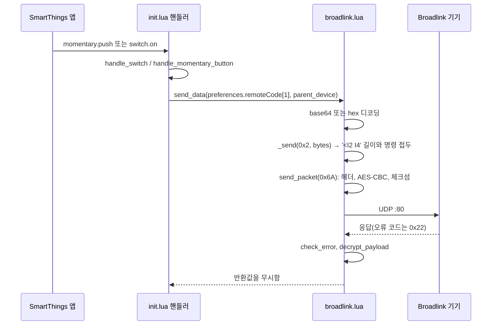
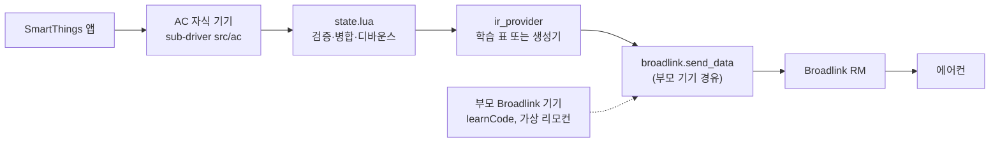

# smartthings-ac-edge 저장소 분석 및 에어컨 드라이버 설계안 (Phase 1–2)

> [!NOTE]
> 이번 분석에서는 저장소를 수정하지 않았습니다. 정적 소스 분석과 외부 문서·참조 구현 조회만 수행했으며, 코드 실행, 패키징, 하드웨어 테스트는 하지 않았습니다.
> 표기: **✅ 확인됨** = 소스 코드나 조회한 문서에서 직접 확인함 · **🔶 추론** = 합리적으로 해석했지만 검증이 필요함 · **❓ 미확인** = 하드웨어, 계정 또는 실험이 필요함

- 기준 커밋: `2a8f48b` (`main`). upstream `frostmar/smartthings-broadlink-edge`의 HEAD와 같음 ✅
- 작업 트리: `AGENTS.md`만 untracked이며, 나머지 파일은 변경되지 않음 ✅
- 외부 참조로 python-broadlink `master`(`remote.py`, `__init__.py`, `device.py`, `protocol.md`)와 SmartThingsEdgeDrivers `main`(공식 드라이버의 프로필·소스)을 조회함
- 커뮤니티 스레드(274700)의 게시글은 작성자 글 1개뿐이며, 제3자 호환성 보고는 없음 ✅

---

## 1. 저장소 구조와 주요 파일

| 경로 | 역할 | 비고 |
|---|---|---|
| [config.yaml](file:///c:/Users/dave0/Desktop/Projects/smartthings-ac-edge/config.yaml) | 드라이버 패키지 메타데이터 | `name: "Broadlink Remote"`, `packageKey: "LAN-Broadlink-RM"`, 권한은 `lan`, `discovery` ✅ |
| [src/init.lua](file:///c:/Users/dave0/Desktop/Projects/smartthings-ac-edge/src/init.lua) | 진입점, Driver 정의, capability 핸들러 | `create_new_device`, `handle_momentary_button`, `handle_switch`, `handle_learn` ✅ |
| [src/disco.lua](file:///c:/Users/dave0/Desktop/Projects/smartthings-ac-edge/src/disco.lua) | 검색(discovery)과 기기 생성 | `disco.handle_discovery`, `disco.do_discover`, 로컬 함수 `create_device` ✅ |
| [src/lifecycles.lua](file:///c:/Users/dave0/Desktop/Projects/smartthings-ac-edge/src/lifecycles.lua) | 수명 주기(lifecycle) 핸들러 | `init`, `added`, `removed` ✅ |
| [src/broadlink.lua](file:///c:/Users/dave0/Desktop/Projects/smartthings-ac-edge/src/broadlink.lua) | Broadlink 프로토콜(UDP, AES, 체크섬) | 전송 계층 전체 ✅ |
| [src/devicetypes.lua](file:///c:/Users/dave0/Desktop/Projects/smartthings-ac-edge/src/devicetypes.lua) | 지원하는 device type ID 표 | `0x5f36`, `0x6507`, `0x6508`만 등록됨 ✅ |
| [src/config.lua](file:///c:/Users/dave0/Desktop/Projects/smartthings-ac-edge/src/config.lua) | 상수 | 타임아웃 10초, 학습 폴링 최대 20회, AES 초기 키와 IV ✅ |
| [src/lockbox/](file:///c:/Users/dave0/Desktop/Projects/smartthings-ac-edge/src/lockbox) | AES-128-CBC 라이브러리 | rtyle/lua-lockbox의 `smartthings-edge` 브랜치를 내장함 ✅ |
| [profiles/BroadlinkRM.yaml](file:///c:/Users/dave0/Desktop/Projects/smartthings-ac-edge/profiles/BroadlinkRM.yaml) | 부모 기기 프로필 `BroadlinkRM.v1` | `main`(momentary), `learn`(custom), `newVirtualRemoteDevice`(momentary) ✅ |
| [profiles/BroadlinkRM-VirtualRemote-1btn.yaml](file:///c:/Users/dave0/Desktop/Projects/smartthings-ac-edge/profiles/BroadlinkRM-VirtualRemote-1btn.yaml) | 자식 가상 리모컨 프로필 | `switch`와 `momentary`, preference `remoteCode1` ✅ |
| [capabilities/forgottenpeace60271.learnCode*.yaml](file:///c:/Users/dave0/Desktop/Projects/smartthings-ac-edge/capabilities/forgottenpeace60271.learnCode.yaml) | 커스텀 capability와 presentation | 명령 `doLearn`, 속성 `code`. CLI로 별도 생성해야 함 ✅ |
| [pronto2broadlink.py](file:///c:/Users/dave0/Desktop/Projects/smartthings-ac-edge/pronto2broadlink.py) | Pronto Hex → Broadlink 형식 변환(PC용) | Broadlink IR 데이터 형식을 보여 주는 참고 자료 ✅ |
| [README.md](file:///c:/Users/dave0/Desktop/Projects/smartthings-ac-edge/README.md), [README_development.md](file:///c:/Users/dave0/Desktop/Projects/smartthings-ac-edge/README_development.md) | 사용법, 제한 사항, CLI 요약 | "RM mini 3만 지원하며 RM4 mini는 수정 없이는 동작하지 않을 가능성이 높음" ✅ |

- 테스트, 린트 설정, CI가 없음 ✅
- 라이선스: MIT (Copyright (c) 2023 Mark Frost). lockbox에는 별도 LICENSE가 있음 ✅
- `.gitignore`에 `lua_libs-api_v2/`가 있음. 작성자는 로컬 Edge 라이브러리를 참조한 것으로 보임 🔶

---

## 2. Broadlink 검색부터 IR 송신까지의 실행 흐름

### 2.1 검색, 모델 식별, 기기 생성 ✅

1. 앱에서 *기기 추가 → 스캔*을 실행하면 `Driver{discovery = disco.handle_discovery}`가 호출됨 ([init.lua#L113](file:///c:/Users/dave0/Desktop/Projects/smartthings-ac-edge/src/init.lua#L109-L134))
2. [`disco.handle_discovery`](file:///c:/Users/dave0/Desktop/Projects/smartthings-ac-edge/src/disco.lua#L67-L71)가 `disco.do_discover(driver, create_device)`를 호출함
3. [`broadlink.broadcast_discovery`](file:///c:/Users/dave0/Desktop/Projects/smartthings-ac-edge/src/broadlink.lua#L121-L150)
   - 0x30바이트 hello 패킷을 만듦(시간 필드, `0x26 = 0x06`, `add_checksum`)
   - `255.255.255.255:80`으로 UDP 브로드캐스트를 보냄
   - `receivefrom()`을 **한 번만** 호출하며, 대기 시간은 10초임
4. [`broadlink.parse_discovery_resp`](file:///c:/Users/dave0/Desktop/Projects/smartthings-ac-edge/src/broadlink.lua#L155-L166)
   - 응답의 0x34 위치에서 device type(LE16)을 읽음
   - 0x3a–0x3f 위치의 MAC을 역순으로 읽음
5. [`disco.do_discover`](file:///c:/Users/dave0/Desktop/Projects/smartthings-ac-edge/src/disco.lua#L41-L64)가 `driver._macaddr_to_ip`와 `driver._macaddr_to_device_type`에 캐시함. 이 캐시는 메모리에만 있음
6. 로컬 함수 [`create_device`](file:///c:/Users/dave0/Desktop/Projects/smartthings-ac-edge/src/disco.lua#L16-L36)
   - `devicetypes[('0x%4x'):format(type)]`를 조회하며, 표에 없으면 기기를 생성하지 않음
   - 표에 있으면 `try_create_device{type='LAN', device_network_id=MAC, profile='BroadlinkRM.v1', vendor_provided_label='Broadlink IR Remote '..MAC}`를 호출함
7. [`lifecycle_handler.init`](file:///c:/Users/dave0/Desktop/Projects/smartthings-ac-edge/src/lifecycles.lua#L12-L64)
   - `device_network_id`가 `BroadlinkRM_Virtual`로 시작하면 아무것도 하지 않음
   - 캐시가 없으면 `disco.do_discover(driver, nil)`로 다시 검색함
   - `set_field("ip")`, `set_field("broadlink_device_type")`를 설정함
8. [`broadlink.auth`](file:///c:/Users/dave0/Desktop/Projects/smartthings-ac-edge/src/broadlink.lua#L347-L370)
   - 0x50바이트 인증 페이로드를 초기 키로 암호화해 `send_packet(0x65, ...)`로 보냄
   - 응답에서 `broadlink_device_id`와 세션 AES 키를 `set_field`로 저장함
   - `persist` 옵션이 없으므로 드라이버를 재시작할 때마다 다시 인증함

> **모델 식별 방식**: 검색 응답의 device type을 하드코딩된 표([devicetypes.lua](file:///c:/Users/dave0/Desktop/Projects/smartthings-ac-edge/src/devicetypes.lua#L6-L10))와 비교하는 방식뿐입니다. 전송 코드에는 모델별 분기가 없습니다. device type 값은 패킷 헤더 0x24에 그대로 들어갑니다. ✅

### 2.2 SmartThings 명령 → IR 송신 ✅



| 단계 | 파일과 심볼 | 내용 |
|---|---|---|
| 1 | Driver `capability_handlers` [init.lua#L119-L130](file:///c:/Users/dave0/Desktop/Projects/smartthings-ac-edge/src/init.lua#L119-L130) | `switch.on/off` → `handle_switch`, `momentary.push` → `handle_momentary_button`, `learnCode.doLearn` → `handle_learn` |
| 2a | [`handle_switch`](file:///c:/Users/dave0/Desktop/Projects/smartthings-ac-edge/src/init.lua#L80-L92) | `on`이면 이벤트를 내보낸 뒤 `handle_momentary_button`을 호출함. **1초 뒤 항상 `off` 이벤트**를 내보냄. `off` 명령은 IR을 보내지 않음 |
| 2b | [`handle_momentary_button`](file:///c:/Users/dave0/Desktop/Projects/smartthings-ac-edge/src/init.lua#L55-L77) | `vendor_provided_label`이 `'Broadlink IR Remote '`로 시작하면 부모로 보고 `preferences.remoteCode`를 보냄. 그렇지 않으면 자식으로 보고 `get_parent_device()`를 거쳐 `preferences.remoteCode1`을 보냄. 컴포넌트가 `newVirtualRemoteDevice`이면 `create_new_device`를 호출함 |
| 3 | [`broadlink.send_data`](file:///c:/Users/dave0/Desktop/Projects/smartthings-ac-edge/src/broadlink.lua#L300-L309) | `"base64:..."`이면 `st.base64.decode`, 그렇지 않으면 `Array.fromHex`로 디코딩한 뒤 `_send(0x2, ...)`를 호출함. **반환값이 없음** |
| 4 | [`_send`](file:///c:/Users/dave0/Desktop/Projects/smartthings-ac-edge/src/broadlink.lua#L276-L296) | `string.pack('<I2 I4', #data+4, cmd)..data`를 `send_packet(0x6A)`로 보낸 뒤 `check_error`와 복호화를 수행하고 `(data, err)`를 반환함 |
| 5 | [`send_packet`](file:///c:/Users/dave0/Desktop/Projects/smartthings-ac-edge/src/broadlink.lua#L179-L259) | 0x38바이트 헤더(magic, devtype, type, count, MAC, id, payload checksum), 16바이트 패딩, `encrypt_payload`, 전체 체크섬(0x20)을 만든 뒤 `udp:sendto(ip, 80)`, `udp:receive()`(10초)를 수행함 |

- 전제 조건: 부모 기기에 `ip`, `broadlink_device_type`, `broadlink_device_id`, `broadlink_encryption_key` 필드가 설정되어 있어야 함. 이 필드는 2.1의 7–8단계에서 설정됨 ✅

### 2.3 IR 학습, 저장, 불러오기 ✅

- **학습**
  - `learnCode.doLearn`이 [`handle_learn`](file:///c:/Users/dave0/Desktop/Projects/smartthings-ac-edge/src/init.lua#L95-L105)을 호출함
  - `broadlink.enter_learning`이 `_send(0x3)`를 보냄
  - 1초 뒤 [`broadlink.fetch_learned`](file:///c:/Users/dave0/Desktop/Projects/smartthings-ac-edge/src/broadlink.lua#L321-L344)가 `_send(0x4)`를 1초 간격으로 최대 20회 폴링함
- **결과**: `learn` 컴포넌트에 `learnCode.code("base64:...")` 이벤트를 내보내며, 실패하면 `"--no code received--"`를 내보냄
- **저장**: 드라이버는 학습한 코드를 **저장하지 않습니다**
  - 사용자가 웹 대시보드 기록에서 코드를 복사해야 함([README.md#L31](file:///c:/Users/dave0/Desktop/Projects/smartthings-ac-edge/README.md#L28-L32))
  - 복사한 코드를 기기 preference인 `remoteCode`나 `remoteCode1`에 붙여 넣어야 함
- **불러오기**: 송신 시 `st_device.preferences.remoteCode1`을 직접 읽음
- **preference 길이 제한**: `maxLength: 255` ([VirtualRemote-1btn.yaml#L17-L21](file:///c:/Users/dave0/Desktop/Projects/smartthings-ac-edge/profiles/BroadlinkRM-VirtualRemote-1btn.yaml#L11-L21))

### 2.4 패키징, 설치, 배포 ✅

- 패키지 구성: `config.yaml`, `profiles/`, `src/`(진입점 `src/init.lua`)
- `capabilities/*.yaml`은 패키지에 포함되지 않음. 파일 주석에 있는 `smartthings capabilities:create`와 `capabilities:presentation:create` 명령으로 별도 생성해야 함
- CLI([README_development.md#L20-L29](file:///c:/Users/dave0/Desktop/Projects/smartthings-ac-edge/README_development.md#L20-L29)): `edge:drivers:package . -I`, `edge:drivers:install`, `edge:drivers:logcat`
- 배포 방식: README에는 upstream 작성자의 채널 초대 URL만 있음. 이 포크용 채널은 아직 없음 🔶

### 2.5 소스 분석으로 발견한 결함과 위험 요소

| # | 위치 | 확인된 사실 ✅ | 영향 |
|---|---|---|---|
| R1 | [`get_checksum`](file:///c:/Users/dave0/Desktop/Projects/smartthings-ac-edge/src/broadlink.lua#L47-L55) | `checksum % 0xffff`(65535로 나눈 나머지)를 사용함. python-broadlink는 `sum(...) & 0xFFFF`(65536으로 나눈 나머지)를 사용함 | 합계가 0xFFFF 이상이면 체크섬이 1 이상 어긋남. 짧은 TV 코드는 합계가 넘치지 않을 수 있지만, **수백 바이트인 에어컨 코드에서는 넘칠 가능성이 큼** 🔶. 기기가 체크섬을 검증해 패킷을 거부하는지는 ❓ |
| R2 | [`send_packet`#L253-L254](file:///c:/Users/dave0/Desktop/Projects/smartthings-ac-edge/src/broadlink.lua#L246-L258) | `udp:receive()`가 시간 초과로 `nil`을 반환하면 `printhex(nil)`에서 Lua 오류가 발생함. 소켓을 닫지 않으며 재전송도 없음(python-broadlink는 타임아웃 안에서 재전송함) | 실패가 오류 반환이 아닌 예외로 처리됨 |
| R3 | [`send_data`](file:///c:/Users/dave0/Desktop/Projects/smartthings-ac-edge/src/broadlink.lua#L300-L309) | `_send`의 오류 코드를 버림 | 호출한 쪽에서 성공과 실패를 구분할 수 없음. AGENTS.md §5.4와 충돌함 |
| R4 | [`lifecycle_handler.init`#L31-L32](file:///c:/Users/dave0/Desktop/Projects/smartthings-ac-edge/src/lifecycles.lua#L26-L37) | 검색에 실패하면 `device_ip`가 `nil`이 되고 문자열 연결에서 오류가 발생함 | 부모 init이 실패함 |
| R5 | `broadcast_discovery` | 첫 번째 응답만 처리함 | Broadlink 기기가 여러 대이면 불확실함 |
| R6 | `parse_discovery_resp` | MAC 형식 문자열이 `'%2x'`라서 0이 아닌 공백으로 채워짐 | 동작에는 영향이 없을 것으로 봄(`tonumber`가 앞 공백을 허용함) 🔶. DNI가 바뀌므로 수정하지 않는 편이 좋음 |
| R7 | `broadlink.lua` L3 | `require('socket')`을 사용함. `init.lua`는 `cosock.socket`을 사용함 | Edge 환경에서 블로킹 동작이 어떻게 다른지는 ❓. upstream 작성자는 동작했다고 보고함 |
| R8 | `handle_switch` | 상태가 1초 뒤 `off`로 강제 복귀함 | 에어컨 전원 상태로는 **재사용할 수 없음** |
| R9 | `handle_momentary_button` | 부모와 자식을 레이블 접두사로 구분함 | 취약함. 에어컨 자식 기기는 별도 방식으로 구분해야 함 |

---

## 3. 재사용할 수 있는 기존 코드와 그 근거

| 재사용 대상 | 근거 ✅ | 조건 |
|---|---|---|
| `broadlink.send_data`, `_send`, `send_packet`, `auth`, AES, lockbox | 헤더 오프셋, 인증 페이로드(0x50바이트, 0x04–0x13='1'×16, 0x1E=1, 0x2D=1, 0x30="Test 1"), 응답 파싱 오프셋이 python-broadlink `Device.auth`, `send_packet`, `rmminib._send`와 같음 | R1–R3를 하위 호환되게 고쳐야 함 |
| 검색(`disco.*`)과 부모 init | 부모 기기 하나가 인증 상태를 유지하고 자식 기기는 `get_parent_device()`로 송신하는 구조가 이미 동작함(upstream 커밋 `5842df0` "fix child 'virtual remote' devices") | 자식 생성 방식을 그대로 따름 |
| 자식 기기 생성 패턴(`create_new_device`) | `parent_device_id`를 지정한 `try_create_device` | 에어컨용 프로필과 DNI 접두사만 바꾸면 됨 |
| 학습 기능(`handle_learn`, `fetch_learned`, `learnCode`) | 부모 기기의 `learn` 컴포넌트에만 있음 | 에어컨 UI와 분리되어 있음. 코드 수집용으로 유지함 |
| Broadlink IR 데이터 형식 | `pronto2broadlink.py`의 `lirc2broadlink`, protocol.md의 "Sending data", python-broadlink `pulses_to_data`(틱 32.84µs = 269/8192) | 프로토콜에서 IR 명령을 생성하는 방식(B)을 쓸 때 Lua로 이식할 수 있음 |
| `device.thread:call_with_delay`, `cancel_timer` 패턴 | `handle_learn`, `lifecycles.removed`에서 사용함 | 연속 명령의 디바운스에 활용 |

---

## 4. RM Mini 3 및 RM4 Mini 호환성 분석

python-broadlink `__init__.py`의 `SUPPORTED_TYPES`와 `remote.py`를 기준으로 비교했습니다.

| 구분 | python-broadlink 클래스 | `_send` 프레이밍 | 이 저장소 |
|---|---|---|---|
| RM mini 3 (구 펌웨어) `0x2737`, `0x27B7`, `0x27C2`… | `rmmini` | `<I command` + data. 응답 데이터는 `payload[0x4:]` | **지원하지 않음.** devicetypes.lua에 없고 프레이밍도 다름 ✅ |
| RM mini 3 (신 펌웨어) `0x5F36`, `0x6507`, `0x6508` | `rmminib` | `<HI(len+4, command)` + data. 응답 데이터는 `payload[6:p_len+2]` | **소스 수준에서 일치** ✅. 작성자가 기기 1대로 테스트했다고 주장함(README). 독립적인 검증은 ❓ |
| RM4 mini / RM4C mini `0x51DA`, `0x520C`, `0x5216`, `0x521C`, `0x610E`, `0x62BC`, `0x648D`, `0x653A` 등 | `rm4mini(rmminib)` | **`rmminib._send`를 그대로 상속함.** 추가된 것은 센서 명령(`0x24`)뿐임 | devicetypes.lua에 없어서 **기기가 생성되지 않음** ✅ |

- **RM Mini 3**
  - 지원 범위는 "RM mini 3" 제품군 전체가 아니라 신 펌웨어 3개 ID뿐임 ✅
  - 구매하는 RM mini 3의 ID가 무엇인지 미리 고를 수 없음 🔶
- **RM4 Mini**
  - 송신, 학습, 인증의 바이트 형식은 python-broadlink 기준으로 RM mini 3(신)과 같음 ✅
  - 따라서 `devicetypes.lua`에 소문자 키(예: `['0x648d']`)를 추가하는 것만으로 동작할 가능성이 있음 🔶
  - README의 "RM4 mini는 수정이 필요할 것"이라는 문장은 구체적인 근거가 없는 주장임 ✅
  - R1 체크섬 문제는 두 모델에 똑같이 적용됨 🔶
  - 실제 RM4 하드웨어로 확인한 결과는 없음 ❓
- **공통 위험**
  - python-broadlink `device.ping` docstring: "firmware ≥ v53"은 클라우드에 연결되지 않으면 2분마다 ping을 받아야 재부팅하지 않음 ✅(문서)
  - 이 드라이버는 ping을 보내지 않음 ✅. 대상 기기에 해당하는지는 ❓
  - Broadlink 앱의 기기 잠금(lock) 설정 때문에 로컬 제어가 막힐 수 있음 ❓
- **하드웨어 권장**
  - 코드 수정이 0인 후보는 ID `0x5f36`, `0x6507`, `0x6508`인 RM mini 3임
  - 실제 구매에서는 ID를 고를 수 없으므로 **어느 쪽을 사든 먼저 PC에서 python-broadlink로 device type을 확인하는 것**이 가장 작은 실험임
  - RM4 mini라면 device type 한 줄 추가와 송신 테스트가 필요함

---

## 5. 에어컨 전용 SmartThings 프로필과 capability 설계안

### 5.1 표준 capability 검토

| 요구 사항 | 후보 | 확인된 명령과 속성 ✅ (공식 드라이버 소스 기준) | 판단 |
|---|---|---|---|
| 전원 | `switch` | `on`, `off` / `switch` | **채택** |
| 모드 4종 | `airConditionerMode` | `setAirConditionerMode` / `airConditionerMode`, `supportedAcModes` (DeepSmart LAN 에어컨 드라이버에서 사용) | **채택.** 단, Fan 모드의 정확한 값(`fan`인지 `fanOnly`인지)은 ❓ (DeepSmart는 `'fan'`을 사용함) |
| 모드 대안 | `thermostatMode` | 값 `auto`, `cool`, `heat`, `fanonly`, `off` 등 / `supportedThermostatModes` | 기각. `off` 모드가 전원 컨트롤과 중복되고, 에어컨보다는 온도조절기에 맞는 의미임 |
| 목표 온도 1개 | `thermostatCoolingSetpoint` | `setCoolingSetpoint` / `coolingSetpoint`, `coolingSetpointRange{minimum,maximum,step}` | **채택.** Heat 모드에서도 같은 값을 사용함 |
| 온도 대안 | `thermostatHeatingSetpoint` 단독 | DeepSmart `Ac.yml`은 이것 하나만 사용함 | 대안. 둘 중 **하나만** 넣으면 중복이 생기지 않음 |
| 풍속 1개 | `airConditionerFanMode` | `setFanMode` / `fanMode`(`auto`, `low`, `medium`, `high`, `off`…), `supportedAcFanModes` | **채택** |
| 풍속 대안 | `fanSpeed` 또는 `fanSpeedPercent` | — | 기각. 정수 단계라서 에어컨의 auto 풍속을 표현하기 어려움 |

- 공식 Matter `room-air-conditioner.yml`은 `thermostatHeatingSetpoint`와 `thermostatCoolingSetpoint`를 **둘 다** 포함함 ✅
  - 이 구성을 그대로 쓰면 요구 사항(목표 온도 1개)을 위반함
- 프로필의 capability `config.values` 문법은 공식 프로필에서 확인함 ✅
  - 값 제한: `enabledValues`
  - 범위 제한: `range`
- `temperatureMeasurement`는 **넣지 않습니다.** 실제 센서가 없으므로 가짜 값을 만들지 않습니다(AGENTS §5.4)

### 5.2 제안 프로필 (초안, 검증 전)

```yaml
name: BroadlinkRM-AirConditioner.v1
components:
  - id: main
    capabilities:
      - id: switch
        version: 1
      - id: airConditionerMode
        version: 1
      - id: thermostatCoolingSetpoint
        version: 1
        # config.values range는 대상 모델이 확정된 뒤 지정
      - id: airConditionerFanMode
        version: 1
    categories:
      - name: AirConditioner
```

- 런타임 init에서 `supportedAcModes`, `supportedAcFanModes`, `coolingSetpointRange`를 숨김 이벤트(`visibility.displayed=false`)로 내보냄
  - DeepSmart의 `lifecycles.lua`가 같은 패턴을 사용함 ✅
- **커스텀 capability 필요 여부**: 현재 판단으로는 **필요하지 않음** 🔶
  - 커스텀 capability를 검토할 조건 ①: 앱이 `supportedAcModes`를 무시하고 모든 모드를 표시하는 경우
  - 조건 ②: 앱이 Heat 모드에서 "냉방 설정 온도"라는 레이블을 표시해 사용성에 문제가 생기는 경우
  - 조건 ③: Fan 모드를 나타낼 표준 enum 값이 없는 경우
  - 이 세 가지는 모두 ❓이며, 앱에서 실제 화면을 확인해야 판단할 수 있음
- **학습 UI**: 에어컨 기기에 넣지 않고 부모 기기의 기존 `forgottenpeace60271.learnCode`를 그대로 사용함
  - 다른 개발자의 네임스페이스에 있는 capability를 내 드라이버에서 쓸 수 있는지는 ❓
  - 쓸 수 없다면 저장소에 있는 YAML로 내 네임스페이스에 다시 생성함

---

## 6. 에어컨 상태 관리 및 IR 명령 처리 설계안

### 6.1 프로토콜 특성 (대상 에어컨이 정해지지 않아 모두 ❓)

- **전체 상태 방식인지, 개별 명령 방식인지**
  - 일반적으로 에어컨 리모컨은 매 송신마다 전원, 모드, 온도, 풍속 전체를 담음 🔶
  - 일부 기종은 전원 토글 코드나 개별 버튼 코드를 사용함 🔶
- **판별 방법**: 온도만 다르게 학습한 코드 2개를 비교함
  - 두 코드의 차이가 일부 비트(와 체크섬)뿐이면 → 전체 상태 프레임
  - 코드가 버튼마다 고정되어 있으면 → 개별 명령
- **전원 코드가 토글 방식인지 반드시 확인해야 합니다.** 토글 방식이면 낙관적으로 보고한 상태가 반전될 위험이 있습니다

### 6.2 학습 방식(A)과 생성 방식(B) 비교

| 항목 | A: 학습 코드 표 | B: 프로토콜 기반 생성 |
|---|---|---|
| 기존 코드 재사용 | `send_data`와 학습 기능을 그대로 사용함 | `send_data`만 사용하고, Lua 인코더와 pulse→Broadlink 변환을 새로 작성해야 함 |
| 필요한 코드 수(예시 🔶) | 냉방·난방 각각 (온도 15단계 × 풍속 4단계), 자동 수 개, 송풍 4개, 끄기 1개 → **약 130개 이상** | 0개(검증용 샘플 몇 개만 필요) |
| 저장 위치 | preference(255자, 1필드 1코드)는 **비현실적임**. 패키지에 Lua 표로 포함하는 방식이 현실적임 | 해당 없음 |
| 위험 | 수집 작업량이 큼. 학습 시 코드가 잘릴 가능성 ❓ | 프로토콜 정보, 체크섬, 타이밍을 정확히 알아야 함. 참조 구현(예: IRremoteESP8266)에서 해당 기종을 지원하는지 ❓ |

**권장**: 하이브리드입니다. 대표 상태 10여 개를 학습해 프로토콜을 판별하고, 문서화된 프로토콜이면 B를 채택해 생성한 코드와 학습한 코드를 바이트 단위로 비교 검증합니다. 프로토콜을 판별할 수 없거나 상태 공간이 작으면 A를 채택합니다. 두 방식 모두 아래의 `ir_provider` 인터페이스 뒤에 두어 교체할 수 있게 합니다.

### 6.3 상태 모델과 처리 흐름 (설계 제안 🔶)

```lua
-- 내부 표현 (SmartThings 값과 프로토콜 값은 별도 매핑 표로 변환)
state = { power = "on"|"off", mode = "cool"|"heat"|"auto"|"fan",
          setpoint = <number, °C>, fan = "auto"|"low"|"medium"|"high" }
```

1. 핸들러가 명령을 받음
2. `model_config` 기준으로 값을 검증함(지원하지 않는 모드나 범위 밖의 값은 거부하고 로그를 남김)
3. `candidate = merge(committed, change)`를 만듦
4. 디바운스(예: 온도 연타는 약 1초 동안 합침. `call_with_delay`와 `cancel_timer` 사용)
5. `ir_provider.encode(candidate)`로 코드를 얻음. 코드가 없으면 명령을 거부함
6. 부모 기기를 거쳐 `broadlink.send_data`를 호출함. R3를 수정해 `ok, err`를 반환하게 함
7. **성공하면** 상태를 확정하고 `set_field(..., {persist=true})`로 저장한 뒤 capability 이벤트를 내보냄
8. **실패하면** 이전 상태를 다시 내보내 UI를 되돌리고 오류 로그를 남김

- **보고 수준**: 이벤트는 "Broadlink가 패킷을 받았다(ACK)"는 뜻일 뿐, 에어컨이 실제로 동작했다는 뜻이 아닙니다. 이 한계를 README에 명시합니다
- **재시작**: 저장한 마지막 상태를 다시 내보냅니다(추정 상태). 재시작만으로 IR을 송신하지는 않습니다
- **원래 리모컨을 쓴 경우**: 드라이버 상태와 실제 상태가 어긋납니다. 전체 상태 프레임 방식이면 다음 명령에서 자동으로 맞춰집니다
- **전원이 꺼진 상태에서 모드나 온도를 바꾼 경우**: 저장만 하고 송신하지 않는 방식(권장 🔶)과 전원을 켜면서 송신하는 방식 중 하나를 결정해야 합니다(열린 질문)
- **모드별 제약**: Fan 모드의 온도나 Auto 모드의 풍속을 에어컨이 무시하더라도 표준 capability로는 해당 컨트롤을 동적으로 숨길 수 없을 것으로 봅니다 🔶. 값은 저장하되 인코더가 `model_config` 규칙을 적용합니다

---

## 7. 수정하거나 추가해야 할 파일

**구조 선택**: 기존 드라이버를 확장하고, 에어컨은 부모 Broadlink 기기의 **자식 기기**로 만들며, 처리 로직은 **sub-driver**로 분리합니다.

- 근거: 인증, 송신, 학습을 그대로 재사용할 수 있고, 에어컨 UI에 학습 컨트롤이 섞이지 않으며, 기존 가상 리모컨 동작을 바꾸지 않습니다
- Edge의 `sub_drivers`와 `can_handle`은 공식 드라이버에서 널리 쓰는 패턴이지만, 이 저장소에서는 아직 쓰지 않습니다 🔶

| 파일 | 구분 | 목적 |
|---|---|---|
| `profiles/BroadlinkRM-AirConditioner.yaml` | NEW | 5.2의 에어컨 전용 프로필 |
| `src/ac/init.lua` | NEW | SmartThings 어댑터: sub-driver(`can_handle`은 DNI 접두사 `BroadlinkRM_AC_` 기준), 네 capability의 핸들러, 에어컨 전용 init(supported 값과 범위 이벤트, 저장한 상태 복원) |
| `src/ac/state.lua` | NEW | 상태 모델: 검증, 병합, 저장, 이벤트 매핑. 순수 Lua로 작성해 오프라인 테스트가 가능하게 함 |
| `src/ac/model_config.lua` | NEW | 기종 의존 값(모드, 온도 범위와 단계, 풍속, 모드별 규칙)을 한곳에 모음(AGENTS §8) |
| `src/ac/ir_provider.lua` + `codes_<model>.lua` 또는 `protocol_<name>.lua` | NEW | `encode(state) -> code \| nil, err` 인터페이스. A/B 구현체는 프로토콜이 확정된 뒤 작성함 |
| [src/init.lua](file:///c:/Users/dave0/Desktop/Projects/smartthings-ac-edge/src/init.lua) | MODIFY | `sub_drivers`를 등록하고, `newAirConditionerDevice` 컴포넌트를 누르면 에어컨 자식 기기를 생성하는 분기를 추가함 |
| [profiles/BroadlinkRM.yaml](file:///c:/Users/dave0/Desktop/Projects/smartthings-ac-edge/profiles/BroadlinkRM.yaml) | MODIFY | 부모 기기에 `newAirConditionerDevice`(momentary) 컴포넌트를 추가함. 에어컨 UI에는 영향이 없음 |
| [src/lifecycles.lua](file:///c:/Users/dave0/Desktop/Projects/smartthings-ac-edge/src/lifecycles.lua) | MODIFY | 에어컨 자식 기기에서는 Broadlink init을 건너뛰고, R4(`nil` IP)를 방어함 |
| [src/broadlink.lua](file:///c:/Users/dave0/Desktop/Projects/smartthings-ac-edge/src/broadlink.lua) | MODIFY(최소) | R2(`nil` 응답 처리와 소켓 닫기), R3(`send_data`가 `ok, err`를 반환하도록 하되 기존 호출부와 호환). R1 체크섬은 아래 실험으로 확인한 뒤 수정함 |
| [src/devicetypes.lua](file:///c:/Users/dave0/Desktop/Projects/smartthings-ac-edge/src/devicetypes.lua) | MODIFY(조건부) | RM4 mini를 구매한 경우에만 확인한 ID 한 줄을 추가함 |
| [config.yaml](file:///c:/Users/dave0/Desktop/Projects/smartthings-ac-edge/config.yaml) | MODIFY(결정 필요) | upstream과 구분할 `name`과 `packageKey` |
| README.md | MODIFY | 설치 방법, 에어컨 설정 방법, 낙관적 상태 보고의 한계 |

---

## 8. 하드웨어나 에어컨 모델이 없어 아직 검증할 수 없는 사항 ❓

1. 구매할 Broadlink 기기의 실제 device type ID, 펌웨어 버전, 잠금 상태
2. R1 체크섬 차이 때문에 긴 에어컨 코드 송신이 실패하는지 여부
3. Edge 환경에서 `require('socket')`이 어떻게 동작하는지(R7)
4. 대상 에어컨의 프로토콜
   - 전체 상태 방식인지
   - 전원 코드가 토글 방식인지
   - 지원 모드(Heat나 Auto가 있는지), 온도 범위와 단계, 풍속 단계
   - 반복 프레임과 체크섬 구조
5. 에어컨 코드의 길이. 학습한 코드가 preference의 255자 제한을 넘는지, 학습 중 잘리지 않는지
6. 표준 capability의 정확한 enum 값: `airConditionerMode`의 Fan 값, `airConditionerFanMode`가 허용하는 값
   - 공개 API는 401을 반환했으므로 `smartthings capabilities` CLI(로그인 필요)로 확인해야 함
7. SmartThings 앱의 실제 표시
   - `supportedAcModes`로 모드 목록이 제한되는지
   - setpoint 레이블이 어떻게 표시되는지
   - 컨트롤이 중복되지 않는지
8. `forgottenpeace60271.learnCode`를 다른 계정의 드라이버에서 쓸 수 있는지
9. 동시성: 여러 자식 기기가 부모 하나를 통해 동시에 송신할 때의 동작

---

## 9. 권장 아키텍처와 단계별 구현 계획



| 단계 | 내용 | 하드웨어 |
|---|---|---|
| 0 | 대상 에어컨과 리모컨 모델 확정. 프로토콜이 문서화되어 있는지 조사. CLI로 capability 정의 확인 | 불필요 |
| 1 | UI 프로토타입: 에어컨 프로필과 sub-driver를 송신 없이 로그만 남기는 스텁 `ir_provider`로 구성해 앱 화면을 검증. 부모 기기 없이 시험하려면 임시 생성 경로가 필요함 | 허브만 필요 |
| 2 | `state.lua`, `model_config.lua`와 순수 Lua 단위 테스트 | 불필요 |
| 3 | 구매 후 PC에서 python-broadlink로 검색, 학습, 송신을 해 보고 device type 확인과 에어컨 코드 수집 | Broadlink 기기와 에어컨 |
| 4 | 기존 드라이버에 가상 리모컨으로 긴 에어컨 코드를 송신해 Edge 송신 경로와 R1을 검증한 뒤, R1–R3 최소 수정 | 필요 |
| 5 | `ir_provider` 구현(A 또는 B)과 생성 코드·학습 코드 비교 | 필요 |
| 6 | Phase 5 통합 시험: 모드별 동작, 연속 명령, 재시작, 원래 리모컨 혼용 | 필요 |

## 가장 먼저 진행해야 할 작업

**대상 에어컨의 제조사, 모델명, 리모컨 모델을 확정하고 해당 IR 프로토콜이 공개 참조 구현에 문서화되어 있는지 조사하는 것**을 가장 먼저 권장합니다.

- 이 정보 하나로 A/B 방식 선택, 상태 공간 크기, 온도 범위와 단계, 지원 모드(Heat, Auto), 전원 코드의 토글 여부, `model_config` 내용이 모두 정해집니다
- 하드웨어 없이 바로 할 수 있습니다
- Broadlink 기기는 어느 모델이든 송신 경로가 사실상 같으므로(4절), 에어컨 정보가 프로젝트 설계에 훨씬 큰 영향을 줍니다
- 같은 시기에 하드웨어 없이 함께 진행할 수 있는 작업: `smartthings capabilities airConditionerMode 1`과 `airConditionerFanMode 1`로 정확한 enum 값 확인(6절과 8절의 6번 해소)
